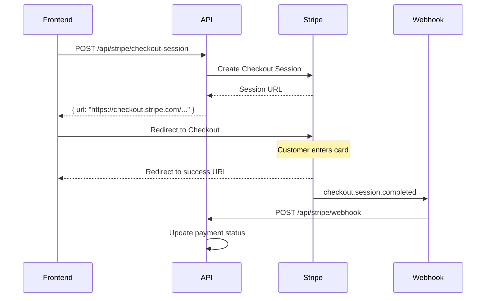
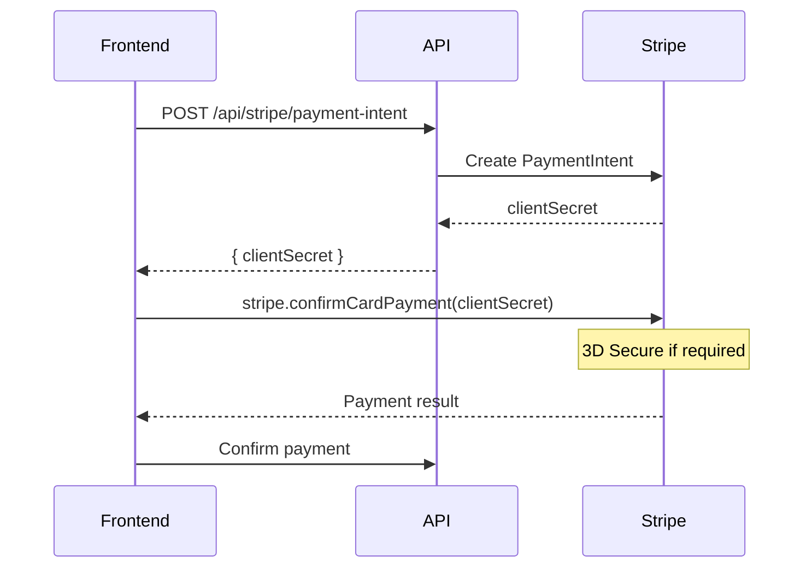

# EShop Stripe Integration

## Overview

Complete Stripe payment gateway integration with:
- Payment Intents (custom card flows)
- Checkout Sessions (Stripe-hosted payment page)
- Refunds (full and partial)
- Customer management (saved cards)
- Webhooks (real-time payment events)

## Quick Start

### 1. Get Your Stripe Keys

1. Go to [Stripe Dashboard](https://dashboard.stripe.com/apikeys)
2. Copy your **Secret Key** (sk_test_xxx) and **Publishable Key** (pk_test_xxx)
3. For webhooks, create an endpoint and copy the **Webhook Secret** (whsec_xxx)

### 2. Configure appsettings.json

```json
{
  "Stripe": {
    "SecretKey": "sk_test_YOUR_SECRET_KEY",
    "PublishableKey": "pk_test_YOUR_PUBLISHABLE_KEY",
    "WebhookSecret": "whsec_YOUR_WEBHOOK_SECRET",
    "DefaultCurrency": "usd",
    "SuccessUrl": "https://yourdomain.com/payment/success?session_id={CHECKOUT_SESSION_ID}",
    "CancelUrl": "https://yourdomain.com/payment/cancel"
  }
}
```

### 3. Register Services

```csharp
builder.Services.AddStripePayments(builder.Configuration);
```

## Payment Flows

### Flow 1: Checkout Session (Recommended)

Best for: Quick integration, mobile-friendly, minimal PCI requirements.



**Frontend:**
```javascript
// Request checkout session
const response = await fetch('/api/stripe/checkout-session', {
  method: 'POST',
  headers: { 
    'Content-Type': 'application/json',
    'Authorization': `Bearer ${accessToken}`
  },
  body: JSON.stringify({
    orderId: 'order-uuid',
    customerId: 'customer-uuid',
    amount: 99.99,
    currency: 'usd',
    lineItems: [
      { name: 'Product Name', unitPrice: 99.99, quantity: 1 }
    ]
  })
});

const { url } = await response.json();

// Redirect to Stripe Checkout
window.location.href = url;
```

### Flow 2: Payment Intent (Custom UI)

Best for: Custom payment forms, full control over UX.



**Frontend (with Stripe.js):**
```javascript
// 1. Load Stripe.js
const stripe = Stripe('pk_test_xxx');
const elements = stripe.elements();

// 2. Create card element
const cardElement = elements.create('card');
cardElement.mount('#card-element');

// 3. Create payment intent
const response = await fetch('/api/stripe/payment-intent', {
  method: 'POST',
  headers: { 'Content-Type': 'application/json', 'Authorization': `Bearer ${token}` },
  body: JSON.stringify({
    orderId: 'order-uuid',
    customerId: 'customer-uuid',
    amount: 99.99,
    currency: 'usd'
  })
});

const { clientSecret } = await response.json();

// 4. Confirm payment
const { error, paymentIntent } = await stripe.confirmCardPayment(clientSecret, {
  payment_method: { card: cardElement }
});

if (error) {
  console.error(error.message);
} else if (paymentIntent.status === 'succeeded') {
  console.log('Payment successful!');
}
```

## API Endpoints

### Configuration
```
GET /api/stripe/config
→ { publishableKey: "pk_test_xxx" }
```

### Payment Intent
```
POST /api/stripe/payment-intent
{
  "orderId": "guid",
  "customerId": "guid",
  "amount": 99.99,
  "currency": "usd",
  "stripeCustomerId": "cus_xxx",      // optional, for saved cards
  "paymentMethodId": "pm_xxx",        // optional
  "receiptEmail": "customer@email.com",
  "savePaymentMethod": true           // save card for future use
}
→ {
  "paymentId": "guid",
  "paymentIntentId": "pi_xxx",
  "clientSecret": "pi_xxx_secret_xxx",
  "status": "requires_payment_method",
  "requiresAction": false
}
```

### Checkout Session
```
POST /api/stripe/checkout-session
{
  "orderId": "guid",
  "customerId": "guid",
  "amount": 99.99,
  "currency": "usd",
  "customerEmail": "customer@email.com",
  "lineItems": [
    { "name": "Product", "unitPrice": 99.99, "quantity": 1 }
  ],
  "shippingOptions": [
    { "displayName": "Standard", "amount": 5.99, "deliveryDays": 5 }
  ],
  "collectShippingAddress": true
}
→ {
  "paymentId": "guid",
  "sessionId": "cs_xxx",
  "url": "https://checkout.stripe.com/...",
  "expiresAt": "2024-01-01T00:30:00Z"
}
```

### Refund
```
POST /api/stripe/refund
{
  "paymentId": "guid",
  "amount": 50.00,           // optional, null for full refund
  "reason": "Customer requested refund",
  "refundType": "CustomerRequest"
}
→ {
  "refundId": "guid",
  "stripeRefundId": "re_xxx",
  "amount": 50.00,
  "status": "succeeded"
}
```

### Customer Management
```
POST /api/stripe/customer
{
  "email": "customer@email.com",
  "name": "John Doe",
  "phone": "+1234567890"
}
→ { "stripeCustomerId": "cus_xxx" }

GET /api/stripe/customer/{stripeCustomerId}/payment-methods
→ [{ "paymentMethodId": "pm_xxx", "cardBrand": "visa", "cardLast4": "4242" }]
```

### Webhook
```
POST /api/stripe/webhook
Headers: Stripe-Signature: xxx
Body: { Stripe event JSON }
```

## Webhook Setup

### Local Development (with Stripe CLI)

1. Install Stripe CLI: https://stripe.com/docs/stripe-cli

2. Login and forward webhooks:
```bash
stripe login
stripe listen --forward-to localhost:5000/api/stripe/webhook
```

3. Copy the webhook secret (whsec_xxx) to your config.

### Production

1. Go to Stripe Dashboard → Developers → Webhooks
2. Add endpoint: `https://yourdomain.com/api/stripe/webhook`
3. Select events:
   - `checkout.session.completed`
   - `checkout.session.expired`
   - `payment_intent.succeeded`
   - `payment_intent.payment_failed`
   - `charge.refunded`
   - `charge.dispute.created`

## Handled Webhook Events

| Event | Action |
|-------|--------|
| `checkout.session.completed` | Mark payment as captured |
| `checkout.session.expired` | Mark payment as failed |
| `payment_intent.succeeded` | Mark payment as captured |
| `payment_intent.payment_failed` | Mark payment as failed |
| `payment_intent.canceled` | Void payment |
| `charge.refunded` | Log refund |
| `charge.dispute.created` | Log dispute (alert admin) |

## Currency Support

The integration automatically handles:
- **Standard currencies** (USD, EUR, GBP): Amount × 100 (cents)
- **Zero-decimal currencies** (JPY, KRW): Amount as-is

Example:
- $99.99 USD → 9999 (cents)
- ¥1000 JPY → 1000 (no conversion)

## 3D Secure

3D Secure is automatically triggered for cards that require it:

```csharp
// Enabled by default in StripeSettings
"Enable3DSecure": true
```

When 3D Secure is required:
1. `PaymentIntentResult.RequiresAction` = true
2. `PaymentIntentResult.NextActionUrl` contains the 3DS URL
3. Frontend should redirect/open in iframe

## Saved Cards

To save cards for future use:

```javascript
// 1. Create or get Stripe customer
const customer = await fetch('/api/stripe/customer', { ... });

// 2. Create payment intent with save flag
const intent = await fetch('/api/stripe/payment-intent', {
  body: JSON.stringify({
    stripeCustomerId: customer.stripeCustomerId,
    savePaymentMethod: true,
    ...
  })
});

// 3. Later, list saved cards
const methods = await fetch(`/api/stripe/customer/${customerId}/payment-methods`);

// 4. Use saved card for future payment
const intent = await fetch('/api/stripe/payment-intent', {
  body: JSON.stringify({
    stripeCustomerId: customerId,
    paymentMethodId: 'pm_xxx',  // saved card
    ...
  })
});
```

## Error Handling

All endpoints return standardized errors:

```json
{
  "type": "https://tools.ietf.org/html/rfc7231#section-6.5.1",
  "title": "Payment creation failed",
  "status": 400,
  "detail": "Your card was declined."
}
```

Common Stripe error codes:
- `card_declined` - Card was declined
- `expired_card` - Card has expired
- `incorrect_cvc` - CVC is incorrect
- `processing_error` - Processing error
- `insufficient_funds` - Insufficient funds

## Testing

### Test Card Numbers

| Card | Number |
|------|--------|
| Visa (Success) | 4242 4242 4242 4242 |
| Visa (Decline) | 4000 0000 0000 0002 |
| Visa (3D Secure) | 4000 0027 6000 3184 |
| Mastercard | 5555 5555 5555 4444 |
| Amex | 3782 822463 10005 |
| Insufficient Funds | 4000 0000 0000 9995 |

Use any future expiry date and any 3-digit CVC.

### Test Webhooks

```bash
# Trigger test events
stripe trigger payment_intent.succeeded
stripe trigger checkout.session.completed
```

## Security Best Practices

1. **Never log full card numbers** - Only log last 4 digits
2. **Use webhooks** - Don't rely solely on client-side confirmation
3. **Verify webhook signatures** - Already handled by the integration
4. **Use HTTPS** - Required for production
5. **Store keys securely** - Use environment variables or secret management
6. **Implement idempotency** - Use payment_id in metadata

## Subscription Support

The integration is ready for subscription payments:

```javascript
// Create subscription checkout
const response = await fetch('/api/stripe/checkout-session', {
  body: JSON.stringify({
    mode: 'subscription',    // Switch to subscription mode
    priceId: 'price_xxx',    // Stripe Price ID
    ...
  })
});
```

Note: Subscription management (cancel, update, pause) requires additional endpoints which can be added as needed.
